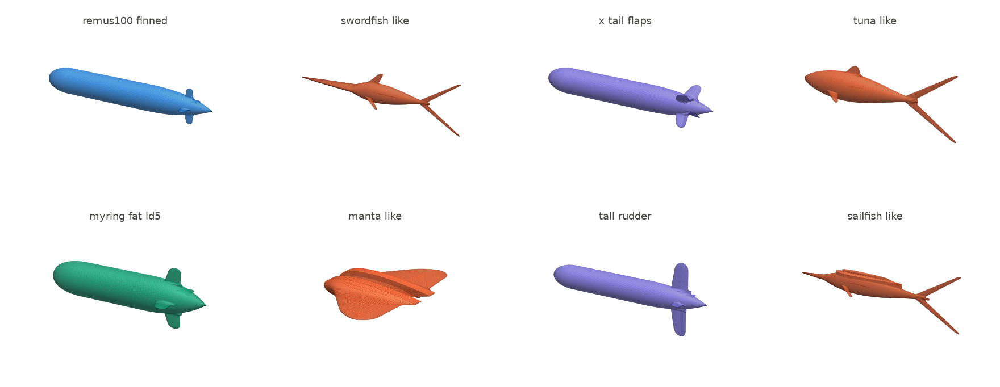
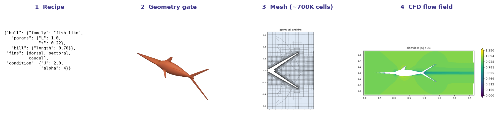
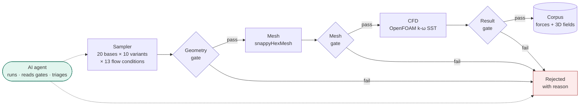
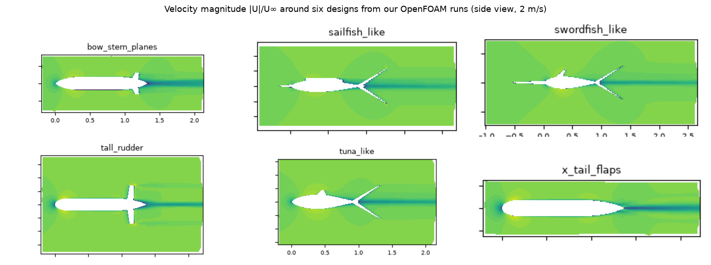
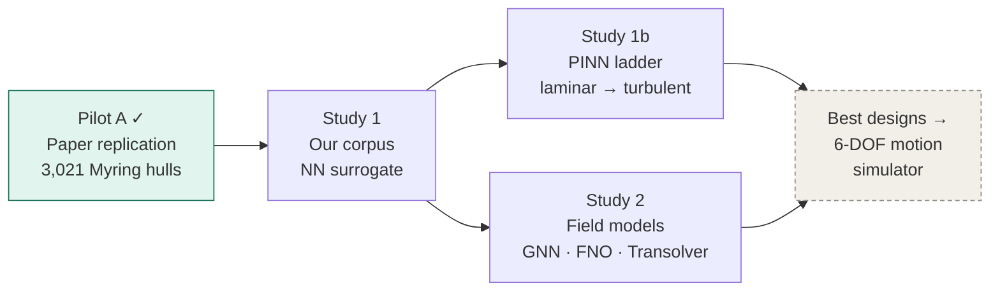
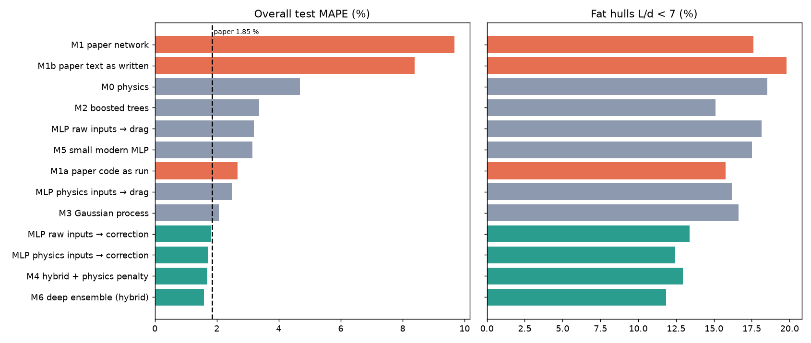

# AUV Physics-AI Lab

**An agentic CFD harness for underwater-vehicle design, and a fair benchmark of physics-AI architectures
(NN, PINN, FNO, graph networks) on the data it produces.**



<p align="center"><i>8 of the 20 core designs: real vehicles (blue), hull families (green), control-surface layouts
(purple) and bio-inspired shapes (orange). Each one is a JSON recipe turned into a watertight solid.</i></p>

| | |
|---|---|
| **The question** | How well can modern physics-AI models replace CFD for vehicle design, and which architecture wins where? |
| **Part 1: the harness** | An automated, agent-operated pipeline: design recipe → geometry check → mesh → OpenFOAM → checked result |
| **Part 2: the benchmark** | One validated corpus, many architectures, the same test splits, honest failure analysis |
| **Status** | Harness core built and validated · paper replication done · corpus pilot next |

---

## 1 · The harness: from design recipe to verified CFD sample



Every sample goes through the same automated stages. Each stage has a **gate**: a sample that fails is logged and
rejected, never silently kept. AI coding agents (Claude Code, Codex) operate the harness through
[`AGENTS.md`](AGENTS.md): they launch runs, read the gate reports and triage failures. A human approves anything
that costs money.



| Stage | What it guarantees | Evidence |
|---|---|---|
| **Geometry gate** | One watertight solid; no needle fin tips, no collars where parts merge | 20/20 core designs and 200/200 variants pass. [Before/after](plan/HARNESS.md) |
| **Mesh** | Same validated recipe for every run (~700K cells, prism layers at y⁺ ≈ 30) | Grid convergence: observed order 1.94, **GCI 0.86 %** |
| **Local accuracy** | Velocity near fins and in the wake, not only drag | All probe lines within **5 %** of the finest grid |
| **CFD** | Repeatable meshes, a convergence-based stop rule | Repeat run gives identical drag |



Details: [harness design](plan/HARNESS.md) · [variant ranges and gallery](plan/VARIANT_RANGES.md) ·
[grid study](results/cfd_gridstudy/)

---

## 2 · The benchmark: which architecture, for what?



| Study | Data | Architectures | Question | Status |
|---|---|---|---|---|
| **Pilot A: paper replication** | 3,021 published Myring-hull CFD runs | Paper NN, MLP, GP, boosted trees, physics hybrid, ensemble | Does the published result hold, and does physics help? | **Done** |
| **Study 1: corpus surrogate** | 2,600 runs: 200 shapes × 13 flow conditions | MLP on forces and moments | Can a network replace CFD for forces on unseen shapes? | Pilot next |
| **Study 1b: PINN ladder** | Physics only, then physics + sparse CFD | PINN, parameterised PINN, hybrid PINN | Where do data-free PINNs stop working? | Planned |
| **Study 2: field models** | Same corpus, full 3D fields | MeshGraphNet, FNO, Transolver | Can a network predict the whole flow field? | Planned |

### Pilot A result: the paper replicated, then beaten with physics



- **Replicated:** the paper's network gets **1.86 %** error on its best seed (paper: 1.85 %). Over 5 seeds it
  averages 2.68 %, because the original script selects runs on the test set.
- **Physics beats architecture:** predicting a correction to a friction-line formula, instead of raw drag, cuts
  error to **1.6–1.7 %** and halves physically wrong predictions.
- **The open problem:** fat hulls (length/diameter < 7) stay at 11–19 % error for every model, because flow
  separation dominates. Our own CFD corpus is built to cover exactly that.

Full write-up: [docs/REPLICATION.md](docs/REPLICATION.md)

### Fair-comparison rules, for every study

- Same splits: unseen variants of known designs, 3 unseen design families, and unseen flow conditions.
- Fixed before training; the test set is used once.
- Reported per model: accuracy, data needed (scaling curve), training cost, inference time, physical consistency.

Plan: [plan/STUDY_PLAN.md](plan/STUDY_PLAN.md)

---

## Repository map

| Folder | What |
|---|---|
| [`design/`](design/) | Parametric geometry, 20 core designs, variants, geometry gate |
| [`cfd/`](cfd/) | OpenFOAM case generator, post-processing, GCP run scripts |
| [`models/`](models/), [`notebooks/`](notebooks/) | Surrogate models and the Pilot A benchmark |
| [`results/`](results/) | Grid study, custom CFD cases, benchmark tables |
| [`plan/`](plan/), [`docs/`](docs/) | Study plan, harness design, replication write-up |

## Reproduce

```bash
python -m venv .venv && .venv/bin/pip install numpy scipy scikit-learn torch matplotlib manifold3d jupyterlab
.venv/bin/python design/quality.py          # geometry gate on the 20 core designs
.venv/bin/python design/variants.py         # 200 gated variants
```
CFD runs need OpenFOAM v2112 (we use a GCP VM, scripts in `cfd/gcp/`). Pilot A needs the paper's data:
see [docs/REPLICATION.md](docs/REPLICATION.md).

## Data and licence

The Pilot A dataset and reference code belong to Vardhan et al. (GPL-3.0); they are not included and are cloned into
the git-ignored `reference/`. All code in this repository was written independently.
