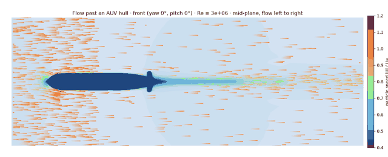
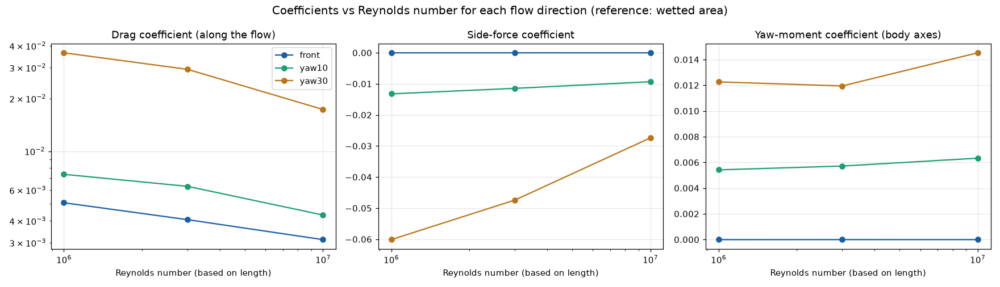
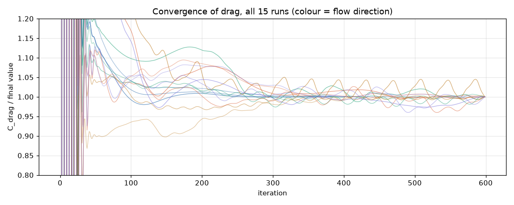
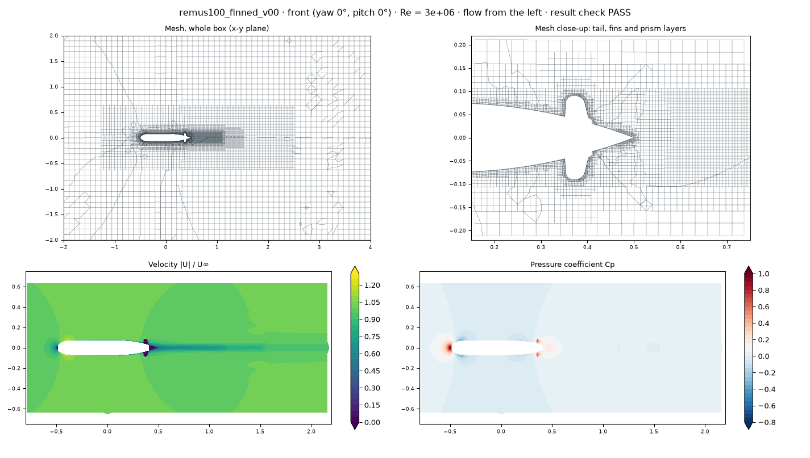
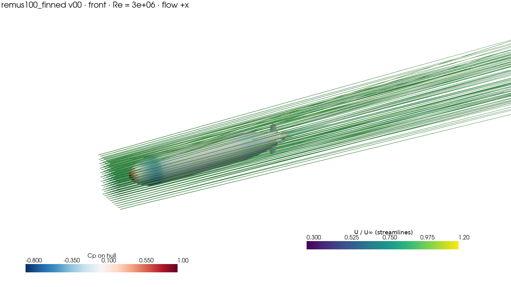

# Pilot: one design, all flow conditions

The first run of the corpus pipeline end to end: one shape (`remus100_finned` variant v00, a REMUS-like hull with a
cruciform tail) through geometry check, meshing, solving, result checks and bucket upload.
[Back to the project page](../README.md)



<p align="center"><i>Mid-plane flow at Re = 3×10⁶: particles slow down at the nose, speed up over the shoulders
and leave a slow wake that recovers downstream. Full video:
<a href="../results/pilot/video2d_front_Re3e6.mp4">video2d_front_Re3e6.mp4</a>. Steady RANS solution: particles follow
the time-averaged flow.</i></p>

## Simulation setup (fixed for the corpus)

| Item | Setting | Why |
|---|---|---|
| Non-dimensional form | Body length L = 1, U∞ = 1, ρ = 1, ν = 1/Re | One box and one mesh recipe for every shape; forces come out as coefficients |
| Flow direction | Body rotated (yaw, pitch); flow always along +x | Same box and wake refinement for every orientation |
| Box | 7 L long (2 L ahead of the nose, 5 L behind the centre); side walls at max(2 L, 2 W) from the axis, W = body span | Domain study below: within the 2.5 % tolerance on the widest shape |
| Mesh | Validated ~700K-cell recipe in units of L: base cell 0.107 L, body surface levels 5–6, near-wake box level 4 | Grid convergence from the earlier study: observed order 1.94, GCI 0.86 % |
| Wall layers | First cell for y⁺ ≈ 30; 2 prism layers up to Re 3×10⁶, 10 at Re 10⁷ | 2 layers failed at Re 10⁷ in the pilot (coverage 1 %) |
| Solver | OpenFOAM v2112 `simpleFoam`, k-ω SST, wall functions | Same as the paper replication |
| Stop rule | Drag varies < 0.1 % over 100 iterations, or the iteration cap | The band at stop is stored as uncertainty |
| Iteration cap | 1,500 (600 in the pilot) | 10° yaw cases had not settled at 600 |
| Checks | Mesh: checkMesh OK and layer coverage ≥ 85 %. Result: drag band < 1 % | Failing runs are labelled, never silently kept |
| Output | Full case, binary and compressed, uploaded to a GCP bucket per run | 70–130 MB per run |

### The 15 flow conditions

| # | Yaw | Pitch | Re | Purpose |
|---|---|---|---|---|
| 1–3 | 0° | 0° | 10⁶, 3×10⁶, 10⁷ | straight ahead: drag vs speed |
| 4–6 | 10° | 0° | 10⁶, 3×10⁶, 10⁷ | turning |
| 7–9 | 20° | 0° | 10⁶, 3×10⁶, 10⁷ | hard turn |
| 10 | 0° | 10° | 3×10⁶ | climbing |
| 11 | 0° | 20° | 3×10⁶ | steep climb |
| 12 | 0° | −10° | 3×10⁶ | diving |
| 13 | 10° | 10° | 3×10⁶ | combined turn and climb |
| 14 | 5° | 0° | 3×10⁶ | small-angle (linear) range |
| 15 | 30° | 0° | 3×10⁶ | edge of the steady range |

Broadside flow (flow from the side or from above, 90°) was run in the pilot and then **removed**: the body sheds
vortices, which a steady solver cannot represent, and the runs never settled.

## Pilot results (6 L box, 600-iteration cap)

Coefficients use the wetted area: C = F / (½ ρ U∞² S).

| Direction | Re 10⁶ | Re 3×10⁶ | Re 10⁷ * | Converged |
|---|---|---|---|---|
| Straight ahead, drag | 0.00507 | 0.00406 | 0.00312 | yes, band 0.03–0.07 % |
| 10° yaw, drag / side force | 0.0074 / −0.013 | 0.0063 / −0.011 | 0.0043 / −0.009 | no, band 1.2–2.7 % at the cap |
| 30° yaw, drag / side force | 0.036 / −0.060 | 0.029 / −0.047 | 0.017 / −0.027 | borderline, band 0.8 % |

\* Prism layers failed at Re 10⁷ in the pilot (mean y⁺ 150–310), so that column is not reliable; fixed for the corpus.

- **Straight-ahead drag is physically sensible.** It sits about 8 % above the ITTC flat-plate friction line
  (form factor ≈ 1.08), typical for a streamlined hull, and falls with Re.
- **Yaw behaves as expected:** side force grows with angle and the yaw moment is positive.
- **Symmetry check passed:** with a cruciform tail, flow from the side and flow from above must give the same forces;
  they agreed within 0.4 % (drag) and 0.3 % (side force vs lift) at Re 10⁶.





### Mesh and flow, straight ahead, Re 3×10⁶





## Problems the pilot found, and the fixes

| Problem | Effect | Fix |
|---|---|---|
| No VM capacity in one zone | First launch failed | Launcher tries all zones in the region, then two other 32-core machine types |
| VM had no permission on the bucket | Uploads failed silently; archives deleted | Bucket-scoped write role for the VM's service account; failed uploads now keep the archive and are logged |
| Prism layers collapsed at Re 10⁷ | y⁺ 150–310, unreliable wall friction | Layer count grows with Re (10 layers at 10⁷) |
| Mesh check labelled low coverage as "PASS_layers" | A failure looked like a pass | Now labelled FAIL |
| 10° yaw did not settle in 600 iterations | Forces carry 1–3 % iteration noise | Cap raised to 1,500 |
| Broadside flow never settles | Steady RANS cannot represent vortex shedding | Side and top removed from the corpus |
| Flow video showed an endless wake | Particles hitting the nose were deleted, leaving an empty band | Particles are also released inside the field; the measured wake recovers to 98 % of U∞ 2.5 L behind the tail |

## Domain independence

One case, the hardest one for the box: `manta_like` v05 (wing span 1.83 L), straight ahead, Re 3×10⁶, in four boxes.
Grid independence is reused from the earlier study, since the near-body mesh is the same recipe.

| Box length | Cross-section | Wingtip-to-wall clearance | Iterations | Drag coefficient | vs 12 L |
|---|---|---|---|---|---|
| 6 L | 4 L × 4 L | 1.1 L | 975 | 0.005346 | +2.6 % |
| 8 L | 5 L × 5 L | 1.6 L | 1,500 (cap, band 0.29 %) | 0.005289 | +1.6 % |
| 10 L | 7 L × 7 L | 2.6 L | 494 | 0.005258 | +1.0 % |
| 12 L | 8 L × 8 L | 3.1 L | 1,053 | 0.005208 | reference |

Tolerance chosen: **2.5 %** against the largest box. Drag falls steadily with box size; the 6 L box is just outside,
8 L is inside. The 10 L and 12 L meshes hit the 4M-cell safety cap (now 8M), so their small difference also contains
a mesh effect. Every run passed the mesh and result checks. Cost ≈ €5.

**Corpus box:** 7 L long, side walls at max(2 L, 2 W). Slim hulls get the 4 L × 4 L section; the manta gets
7.3 L × 7.3 L, wider than the 10 L box above, so the side walls are not the limiting factor for any shape.

## Reproduce

```bash
.venv/bin/python cfd/corpus_case.py remus100_finned 0 --out runs/pilot --cap 1500
bash cfd/gcp/launch.sh runs/pilot pilot 3h
.venv/bin/python cfd/pilot_report.py runs/pilot_results/small/remus100_finned_v00 results/pilot
.venv/bin/python cfd/flow_video_2d.py <case with planes> results/pilot/video2d_front_Re3e6.mp4
```
