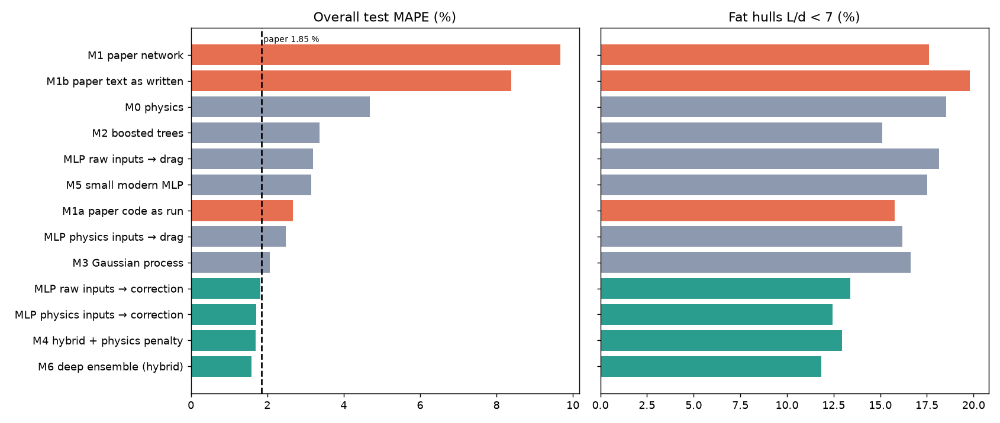

# Pilot A: replication of Vardhan et al. 2023

Paper: *Sample-Efficient and Surrogate-Based Design Optimization of Underwater Vehicle Hulls*
([arXiv 2304.12420](https://arxiv.org/abs/2304.12420)). Same 3,021 OpenFOAM simulations of Myring hulls, same split,
models rebuilt independently and benchmarked fairly. [Back to the project page](../README.md)



## Key findings
1. **The paper's result is reproduced.** Their network, trained as their code runs it, reaches **1.86 %** MAPE
   on its best seed (paper: **1.85 %**). The typical result is **2.68 ± 0.49 %** over 5 seeds.
2. **The paper's number is optimistic.** Their script retrains and keeps runs based on **test-set** error.
   The paper's text and code also differ:
   - **Learning rate:** 3e-4 in the text, 1e-3 in the code.
   - **Dropout:** the text says 0.2; the code creates the layers but never applies them.
   - **Weights:** 22,249 in the text, 23,249 in the code.

   Built as the text describes, the network gets **8.4 %**. Details: [knowledge/01-paper.md](../knowledge/01-paper.md).
3. **Physics helps more than architecture.** With the same small MLP and the same tuning budget (3-fold CV random
   search), predicting a *correction to a friction-line formula* instead of raw drag cuts error from **3.2 % to
   1.7–1.8 %**. Dimensionless inputs add a little on top.
4. **Best models:**

   | Model | Overall error | Fat-hull error |
   |---|---|---|
   | M6, a 5-member ensemble of the hybrid | **1.59 %** | 11.8 % |
   | M4, the hybrid with a monotonicity penalty | **1.69 ± 0.23 %** | 13.0 % |

   Both beat the paper's network and a Gaussian process (2.06 %).
5. **Physical consistency.** On 1,000 random hulls we checked how often predicted drag *drops* when the body gets
   5 % longer, which should never happen:

   | Model | Violations |
   |---|---|
   | Gaussian process | 16.5 % |
   | Boosted trees | 11.1 % |
   | MLP | 9.4 % |
   | M4 with the penalty | 4.1 % |

   Accuracy alone hides this, and it matters for design optimisation.
6. **Data efficiency.** The hybrid reaches **2.1 % with 100 training hulls**; the raw MLP needs about 2,000 for 3.2 %.
   Learning curves are noisy at mid-range N (single seed).
7. **Unsolved: fat hulls (L/d < 7).** Every model makes 11–19 % error on them, because they are dominated by flow
   separation and pressure drag. With all fat hulls removed from training:

   | Model | Fat-hull error |
   |---|---|
   | Gaussian process | 47.7 % |
   | M4 hybrid | 15.1 % |
   | Physics formula alone | 18.5 % |

   This is the motivation for Phase 2 CFD.
8. **Uncertainty.** The ensemble's ±2σ band covers only 78 % of test hulls (ideal 95 %), so it is under-dispersed.

## Models
| ID | Model |
|---|---|
| M0 | Friction-line physics: ITTC-1957 × Hoerner form factor, on wetted area |
| M1 / M1a / M1b | Paper network: our first copy / code as run / text as written |
| M2 | Histogram gradient boosting |
| M3 | Gaussian process (Matérn 2.5, log drag) |
| M5 | Small modern MLP (SiLU), untuned |
| MLP ablation | 2 × 2: raw or dimensionless inputs × drag or correction target, all tuned with the same budget |
| M4 | Hybrid: dimensionless inputs, correction target, monotonicity penalty on unlabelled collocation hulls |
| M6 | Deep ensemble of 5 M4 models |

**Protocol for all models:**
- The paper's split: 2,400 training hulls and 621 test hulls.
- 10 % of the training set held out for validation.
- 5 seeds per model.
- The test set is used once and never for selection.
- Errors are reported overall and per fineness group.

Raw results: [results/benchmark.csv](../results/benchmark.csv).

## Repository
- `notebooks/01_data_exploration.ipynb`: design space, hull gallery, physics view, where models fail, a sample CFD
  case, data quality.
- `notebooks/02_model_benchmark.ipynb`: M0–M5 and the replication check against the paper.
- `notebooks/03_physics_ml.ipynb`: tuning, ablation, M4, M6, consistency audit, learning curves, out-of-distribution
  test.
- `models/`: `physics.py` (Myring geometry, M0), `harness.py` (split, metrics, results log), `nets.py` (the paper
  network and an MLP), `physics_ml.py` (features, hybrid, penalty, audit).
- `scripts/run_m1_variants.py`: the two faithful paper-network versions.
- `knowledge/`, `plan/`: notes on the paper, dataset and flow conditions, and the project plan.

## Reproduce
```bash
git clone https://github.com/vardhah/UUV-design-optimization reference/UUV-design-optimization   # data (GPL-3.0)
python -m venv .venv && .venv/bin/pip install numpy scipy scikit-learn torch matplotlib jupyterlab nbformat
.venv/bin/jupyter lab notebooks/
```
CPU only. Notebook 03 takes about an hour on a laptop.

## Data and licence
The dataset and the reference code belong to Vardhan et al. (GPL-3.0). They are **not** included here; they are
cloned into `reference/`, which is git-ignored. The code in this repository was written independently.
