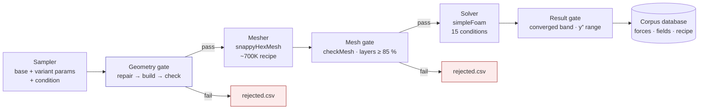
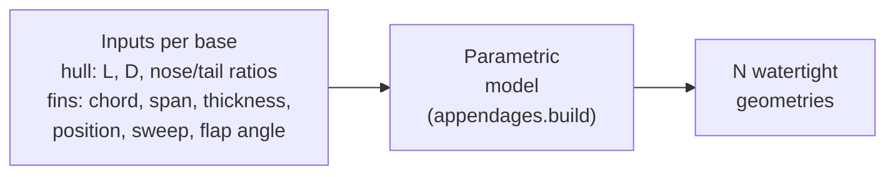
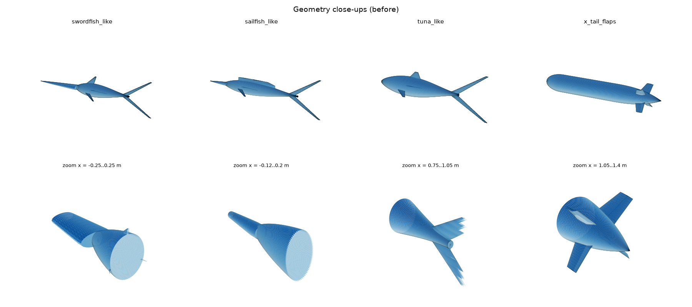
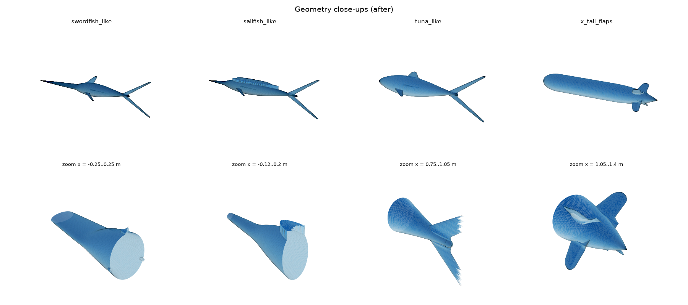

# Harness design

The harness turns a design recipe (JSON) into a checked CFD sample in the corpus database, with no manual step.
Each stage either passes the sample on or rejects it with a logged reason; nothing bad is silently kept.

## Stage 1: sampler

`design/sampler.py` and `design/registry.py`. A sample is `base design + variant parameters + flow condition`.
Variant ranges are set per base (a bill length means nothing on an X-tail hull), in the spirit of the
parametric-modelling block in Li et al. 2026:

## Stage 2: geometry gate (`design/quality.py`), implemented

**Repair**: clamps parameters, logging every change.

| Rule | Limit |
|---|---|
| Tip chord | ≥ 0.35 × root chord (no needle tips) |
| Thinnest fin section | ≥ 2 mm |
| Fin thickness ratio | ≥ 6 % |
| Aspect ratio of one fin or caudal lobe | ≤ 4.5 |

**Build**: what `appendages.build` now does by construction:

- Bill and body form one blended surface. There is no separate cone, so no collar or waist at the junction.
- Fin roots are flared into the hull as a fillet. Sections are thicker and slightly longer near the hull.
- Fin tips are rounded in planform and in thickness, so there is no flat, knife-edged tip face.
- A fish stern ends in a rounded cap, not a flat disc.

**Check**: a design is never meshed unless all of these pass.

| Check | Hard rule |
|---|---|
| Closed manifold, 1 connected solid, genus 0, volume > 0 | yes |
| Fin tip thickness ≥ 2 mm | yes |
| Concave corner on the body outline ≤ 12° (collar or step detector) | yes |
| Sharp-edge fraction, smallest edge, triangle count | logged only |

Result on the 20 reference designs: **20/20 pass** (`design/quality/report.csv`).

| Before | After |
|---|---|
|  |  |

## Stage 3: mesher and mesh gate

`cfd/casegen.py` + `cfd/gcp/custom.sh`. Per-case near-wake box and absolute first-layer height
from the case Reynolds number, repeatable decomposition. Gate: `checkMesh` passes, layer coverage ≥ 85 %.

## Stage 4: solver and result gate

One mesh per shape and condition (the body is rotated, and the wall layer depends on Re). Stop rule:
drag band < 0.1 % over 100 iterations, capped at 600 iterations; the band is stored as an uncertainty.
Result gate: band < 1 %, mean y⁺ in 20–60.

## Stage 5: corpus database

Per run: recipe JSON, gate reports, 6 forces and moments, convergence band, y⁺, layer coverage, surface p and τ_w,
volume fields on a fixed point cloud and on a 128×64×64 grid. Stored in a GCP bucket, indexed by one CSV.

## Status

| Stage | State |
|---|---|
| Sampler | **Done**: per-base variants in `design/variants.py`, 200 designs in `design/variants/` |
| Geometry gate | **Done** |
| Mesher + mesh gate | Recipe done; gate thresholds to wire in |
| Solver + result gate | Done for one condition; multi-condition mapped runs to add |
| Corpus database | Field export format to add |
