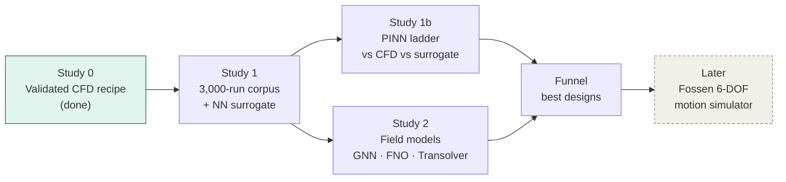
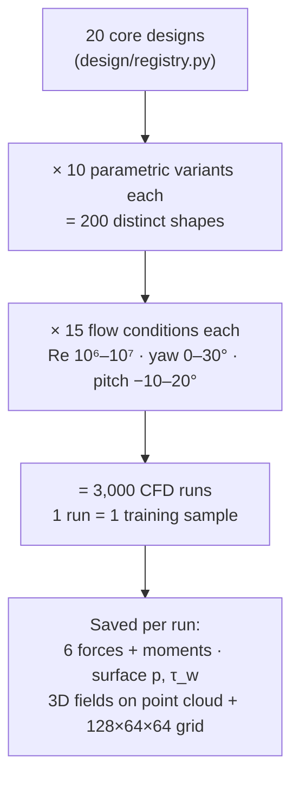
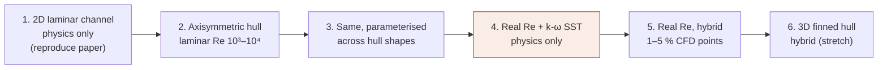

# Study plan: CFD corpus → surrogates → PINN and operator benchmark

Goal: one validated CFD corpus of AUV designs, and on it an honest comparison of physics-AI architectures
(plain NN, PINN, FNO, graph networks, Transolver). Motion simulation comes later, only for the designs that
survive the funnel. Fixed on 2026-11-23, before any corpus run.

## Study 0: CFD recipe (done)

| Item | Result |
|---|---|
| Solver | OpenFOAM v2112 `simpleFoam`, k-ω SST, wall functions, absolute prism layers at y⁺ ≈ 30 |
| Grid convergence (swordfish_like, 145K to 1.16M cells) | Observed order 1.94, GCI_fine 0.86 %, Cd monotonic |
| Local check | Every probe line within 5 % of the finest grid at 653K cells |
| Production recipe | ~700K cells, near-wake level-3 box, repeatable (simple) decomposition |
| Results | `results/cfd_gridstudy/`, `results/cfd_custom/` |

## Study 1: the corpus

| Decision | Choice | Why |
|---|---|---|
| Shapes vs conditions | 10 variants × 15 conditions | Every shape gets drag and side-force curves vs speed and angle, which the later motion model needs |
| Density and velocity | Varied through the Reynolds number | In incompressible flow they only enter through Re and dynamic pressure; varying both separately repeats runs |
| Condition sampling | Latin hypercube per shape, plus a 0° cruise anchor | No shape/condition correlation, so no coverage bias |
| Mesh | One recipe for every run (~700K, 600-iteration cap) | Mixing fidelities would hide mesh error inside the design effect |
| Mesh-error check | ~50 runs repeated at ~1.2M cells | Reported as uncertainty, never used for training |
| Waves | Not in this corpus | Needs a free-surface solver (10–50× cost); later, as a depth parameter |
| Geometry | Every shape passes the quality gate (`design/quality.py`) | No bad junctions or needle tips reach the mesher |

The 15 flow conditions (dimensionless: body length 1, U = 1, Re = 1/ν; the body is rotated, flow is always +x):

| # | Yaw | Pitch | Re | Purpose |
|---|---|---|---|---|
| 1–3 | 0° | 0° | 10⁶, 3×10⁶, 10⁷ | straight ahead: drag vs speed |
| 4–6 | 10° | 0° | 10⁶, 3×10⁶, 10⁷ | turning |
| 7–9 | 20° | 0° | 10⁶, 3×10⁶, 10⁷ | hard turn |
| 10 | 0° | 10° | 3×10⁶ | climbing |
| 11 | 0° | 20° | 3×10⁶ | steep climb |
| 12 | 0° | −10° | 3×10⁶ | diving (asymmetric bodies differ from climbing) |
| 13 | 10° | 10° | 3×10⁶ | combined turn and climb |
| 14 | 5° | 0° | 3×10⁶ | small-angle (linear) manoeuvring range |
| 15 | 30° | 0° | 3×10⁶ | edge of the steady range (flagged if it does not settle) |

Broadside flow (90° side or top) is excluded: it sheds vortices and steady RANS cannot settle (pilot, 23 Nov).

Variant ranges per base, gallery and split assignment: [VARIANT_RANGES.md](VARIANT_RANGES.md)
(200/200 variants pass the geometry gate; 136 train, 34 unseen-variant, 30 unseen-base).

Test splits, fixed before training:

| Split | Held out | Question |
|---|---|---|
| Unseen variant | 2 of 10 variants in every base | New shape of a known kind of vehicle |
| Unseen base | 3 of the 20 bases entirely | New kind of vehicle |
| Unseen condition | Top of the speed range, angles above 9° | Extrapolation |

Budget (from the pilot, 4–8 VM-minutes per run): ~150–200 VM-hours (≈ €200–260 on demand, €70–90 on spot). Storage ≈ 300–350 GB at the measured 70–130 MB per run.
A 40-shape pilot runs first to measure failure rate, runtime and convergence.

## Study 1b: PINN ladder

Data-free PINNs work for laminar, smooth problems (e.g. Gammaidoni et al., *Computers & Fluids* 2026,
microchannels). Our flows are turbulent (Re ~10⁶), 3D and finned. The ladder finds where they stop working.

Step 4 is the expected breaking point. Every step is scored against CFD and against the Study 1 surrogate on:
field error, force error, training time, and cost per new design.

## Study 2: field models

Same corpus, same splits: MeshGraphNet / graph network on the CFD mesh, FNO on the regular grid,
Transolver on the point cloud, plain MLP on forces. Output: one table of accuracy, data needed
(scaling curve over 100 / 300 / 1000 / 2600 runs), training cost and inference time.

## Reading

Karniadakis et al. 2021 (*Nat. Rev. Phys.*) · Raissi et al. 2019 (PINN) · Krishnapriyan et al. 2021 (PINN failure
modes) · Li et al. 2021 (FNO) · Pfaff et al. 2021 (MeshGraphNets) · Wu et al. 2024 (Transolver) ·
Takamoto et al. 2022 (PDEBench) · Li et al. 2026 *Appl. Ocean Res.* 175:105219 (AUV Kriging MDO).
