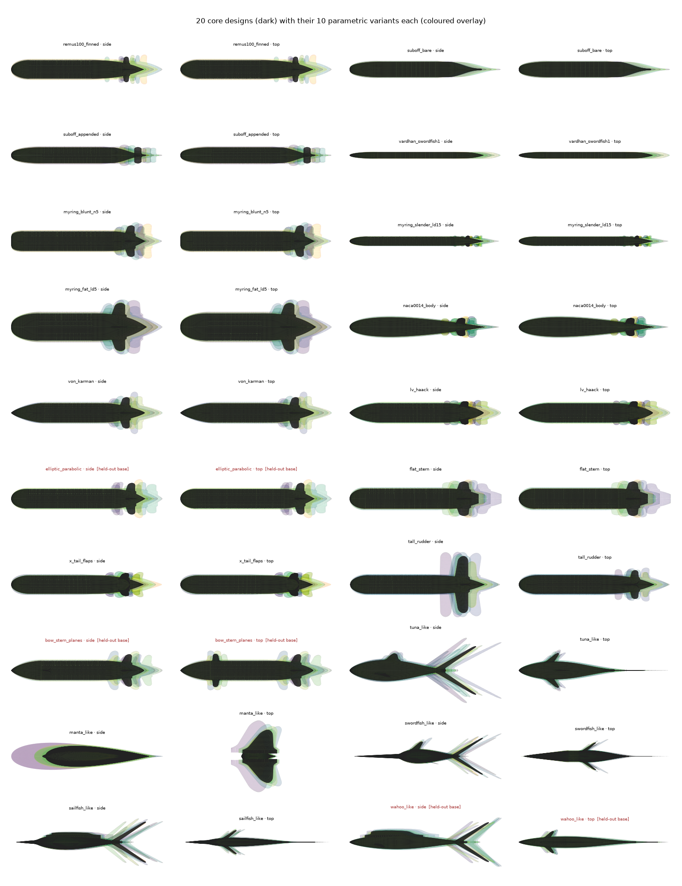

# Variant ranges (Study 1 corpus)

Generated by `design/variants.py`. 20 core designs × 10 Latin-hypercube variants = 200 shapes; each is run at
13 flow conditions in the corpus. Fins scale and move with the hull. Every variant passes the geometry gate.

Gate result: **200/200 variants pass**.

## Features

| Feature | Range | Meaning |
|---|---|---|
| `length_scale` | ×0.85–1.15 | body length (nose, mid-body and tail lengths together) |
| `diam_scale` | ×0.85–1.15 | maximum diameter |
| `myring_n` | ×0.75–1.25 | Myring nose fullness n (relative to the base) |
| `myring_theta` | -8 to +8 | Myring tail half-angle (deg, around the base) |
| `haack_C` | -0.05 to +0.05 | Haack shape constant C (around the base, so Von Kármán and LV-Haack stay apart) |
| `tail_power` | -0.4 to +0.4 | parabolic tail exponent (around the base) |
| `stern_ratio` | -0.1 to +0.1 | flat-stern base radius / max radius (around the base) |
| `fish_x_max` | -0.04 to +0.04 | position of maximum thickness (fraction of L) |
| `fish_width` | ×0.9–1.1 | body width / height |
| `bill_scale` | ×0.75–1.25 | bill length |
| `fin_span` | ×0.75–1.25 | span of every fin |
| `fin_chord` | ×0.85–1.15 | root and tip chord of every fin |
| `fin_sweep` | -10 to +10 | leading-edge sweep (deg) |
| `fin_x` | -0.03 to +0.03 | fin position along the body (fraction of L) |
| `ctrl_angle` | ×0–1.5 | deflection and flap angles of control surfaces (0 = undeflected) |

## Features per base

| Base | Category | Split | Features varied |
|---|---|---|---|
| `remus100_finned` | vehicle | train (v08, v09 held out) | `length_scale`, `diam_scale`, `myring_n`, `myring_theta`, `fin_span`, `fin_chord`, `fin_sweep`, `fin_x` |
| `suboff_bare` | vehicle | train (v08, v09 held out) | `length_scale`, `diam_scale` |
| `suboff_appended` | vehicle | train (v08, v09 held out) | `length_scale`, `diam_scale`, `fin_span`, `fin_chord`, `fin_sweep`, `fin_x` |
| `vardhan_swordfish1` | dataset | train (v08, v09 held out) | `length_scale`, `diam_scale`, `myring_n`, `myring_theta` |
| `myring_blunt_n5` | myring | train (v08, v09 held out) | `length_scale`, `diam_scale`, `myring_n`, `myring_theta`, `fin_span`, `fin_chord`, `fin_sweep`, `fin_x` |
| `myring_slender_ld15` | myring | train (v08, v09 held out) | `length_scale`, `diam_scale`, `myring_n`, `myring_theta`, `fin_span`, `fin_chord`, `fin_sweep`, `fin_x` |
| `myring_fat_ld5` | myring | train (v08, v09 held out) | `length_scale`, `diam_scale`, `myring_n`, `myring_theta`, `fin_span`, `fin_chord`, `fin_sweep`, `fin_x` |
| `naca0014_body` | family | train (v08, v09 held out) | `length_scale`, `diam_scale`, `fin_span`, `fin_chord`, `fin_sweep`, `fin_x` |
| `von_karman` | family | train (v08, v09 held out) | `length_scale`, `diam_scale`, `haack_C`, `fin_span`, `fin_chord`, `fin_sweep`, `fin_x` |
| `lv_haack` | family | train (v08, v09 held out) | `length_scale`, `diam_scale`, `haack_C`, `fin_span`, `fin_chord`, `fin_sweep`, `fin_x` |
| `elliptic_parabolic` | family | held out (unseen base) | `length_scale`, `diam_scale`, `tail_power`, `fin_span`, `fin_chord`, `fin_sweep`, `fin_x` |
| `flat_stern` | family | train (v08, v09 held out) | `length_scale`, `diam_scale`, `myring_n`, `myring_theta`, `stern_ratio`, `fin_span`, `fin_chord`, `fin_sweep`, `fin_x` |
| `x_tail_flaps` | appendage | train (v08, v09 held out) | `length_scale`, `diam_scale`, `myring_n`, `myring_theta`, `fin_span`, `fin_chord`, `fin_sweep`, `fin_x`, `ctrl_angle` |
| `tall_rudder` | appendage | train (v08, v09 held out) | `length_scale`, `diam_scale`, `myring_n`, `myring_theta`, `fin_span`, `fin_chord`, `fin_sweep`, `fin_x`, `ctrl_angle` |
| `bow_stern_planes` | appendage | held out (unseen base) | `length_scale`, `diam_scale`, `haack_C`, `fin_span`, `fin_chord`, `fin_sweep`, `fin_x`, `ctrl_angle` |
| `tuna_like` | bio | train (v08, v09 held out) | `length_scale`, `diam_scale`, `fish_x_max`, `fish_width`, `fin_span`, `fin_chord`, `fin_sweep`, `fin_x` |
| `manta_like` | bio | train (v08, v09 held out) | `length_scale`, `diam_scale`, `fish_x_max`, `fish_width`, `fin_span`, `fin_chord`, `fin_sweep`, `fin_x` |
| `swordfish_like` | bio | train (v08, v09 held out) | `length_scale`, `diam_scale`, `fish_x_max`, `fish_width`, `bill_scale`, `fin_span`, `fin_chord`, `fin_sweep`, `fin_x` |
| `sailfish_like` | bio | train (v08, v09 held out) | `length_scale`, `diam_scale`, `fish_x_max`, `fish_width`, `bill_scale`, `fin_span`, `fin_chord`, `fin_sweep`, `fin_x` |
| `wahoo_like` | bio | held out (unseen base) | `length_scale`, `diam_scale`, `fish_x_max`, `fish_width`, `fin_span`, `fin_chord`, `fin_sweep`, `fin_x` |

Splits: variants v08 and v09 of every base are the unseen-variant test set; the three held-out bases
(`wahoo_like`, `elliptic_parabolic`, `bow_stern_planes`) are the unseen-base test set and never appear in training.
